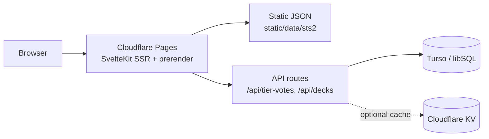

<div align="center">

# STS2 Hub

**A fan-made Slay the Spire 2 companion: deck builder, card database, community tier list and guides.**


</div>

> **Disclaimer:** This is an unofficial, fan-made project. It is not affiliated with, endorsed by, or associated with Mega Crit or Slay the Spire. All game names, content and trademarks belong to their respective owners.

---

## About

STS2 Hub is a free web companion for Slay the Spire 2 players who want to plan runs, look things up quickly and compare notes with the community. It bundles a visual deck builder with shareable deck codes, a searchable game database, community-voted card tiers and strategy guides in one fast, multilingual site. The project was split out of a larger gaming platform (ggez.gg) into a standalone SvelteKit app deployed on Cloudflare Pages.

## Features

- **Deck builder**: pick a character, add cards, relics and potions, and see deck stats (cost curve, type split) plus automatically detected synergies and warnings.
- **Shareable decks**: the full deck state is encoded into a compact URL-safe code (`/shared/[deckCode]`) with a social share modal.
- **Game database**: cards, relics, potions, monsters, events and enchantments in one tabbed database with filters and rich hover tooltips; legacy routes redirect to the right tab.
- **Community tier list**: anonymous, session-based S to D tier votes per character, aggregated server-side with caching.
- **Guides**: general strategy guides, boss guides and tips pages.
- **Synergies page** explaining card and relic interactions.
- **9 languages**: English, German, French, Spanish, Russian, Turkish, Japanese, Korean and Chinese via `svelte-i18n`, including localized card and item data.
- **SEO-ready**: canonical URLs, Open Graph images, JSON-LD breadcrumbs, prerendered key pages and long-lived cache headers for static assets and game data.
- **Mobile-friendly** layout with dedicated mobile navigation.

> **Status:** the deck gallery API (`/api/decks`) is in place, but saving and up-voting decks require a user account, which the standalone hub does not have yet. Browsing, building, sharing via deck code and tier voting work without an account.

## Tech stack

| Area | Technology |
| --- | --- |
| Framework | SvelteKit 2, Svelte 5 (legacy mode), Vite 5 |
| Language | TypeScript |
| Styling | Tailwind CSS 3, PostCSS, self-hosted fonts |
| Data | Static game data as JSON in `static/data/sts2/` (576 cards plus relics, potions, monsters, events, enchantments, keywords, powers) |
| Database | Turso / libSQL (deck gallery + tier votes); local SQLite file in development |
| i18n | `svelte-i18n` |
| Hosting | Cloudflare Pages (`@sveltejs/adapter-cloudflare`, `wrangler.toml`) |

## Architecture



The database schema is created automatically on the first request (`src/hooks.server.ts` calls `initDB()`), so no manual migration step is required.

## Getting started

**Prerequisites:** Node.js 18+ and npm.

```bash
npm install
npm run dev       # start the dev server
npm run build     # production build (Cloudflare adapter)
npm run preview   # preview the production build
```

In development the app uses a local `file:local.db` SQLite database automatically. For production, copy `.env.example` and set these variables (as Cloudflare Pages secrets):

- `TURSO_DATABASE_URL`
- `TURSO_AUTH_TOKEN`

Before deploying, replace the `STS2_DOMAIN` placeholder (canonical URLs, `robots.txt`) with the real domain.

## Project structure

```
.
├── src/
│   ├── hooks.server.ts          # DB init, anonymous sessions, cache headers
│   ├── lib/
│   │   ├── i18n/                # svelte-i18n setup + 9 locales (UI + guides)
│   │   ├── server/db.ts         # libSQL client + schema
│   │   ├── sts2/
│   │   │   ├── components/      # CardBrowser, DeckPanel, DeckStats, tooltips, pickers
│   │   │   ├── data/            # bosses, guides, character themes
│   │   │   ├── stores/          # deck + hover stores
│   │   │   └── utils/           # deck codes, filters, synergies, upgrades
│   │   └── types/
│   └── routes/
│       ├── build/               # deck builder
│       ├── game-database/       # tabbed database
│       ├── tier-list/           # community tier votes
│       ├── decks/  shared/      # deck gallery + shared deck codes
│       ├── guides/  synergies/  # strategy content
│       └── api/                 # tier-votes + decks endpoints
├── static/data/sts2/            # game data JSON
├── svelte.config.js
└── wrangler.toml                # Cloudflare Pages config
```

---

<div align="center">

Built by [Christoph Barton](https://christophbarton.com)

</div>
